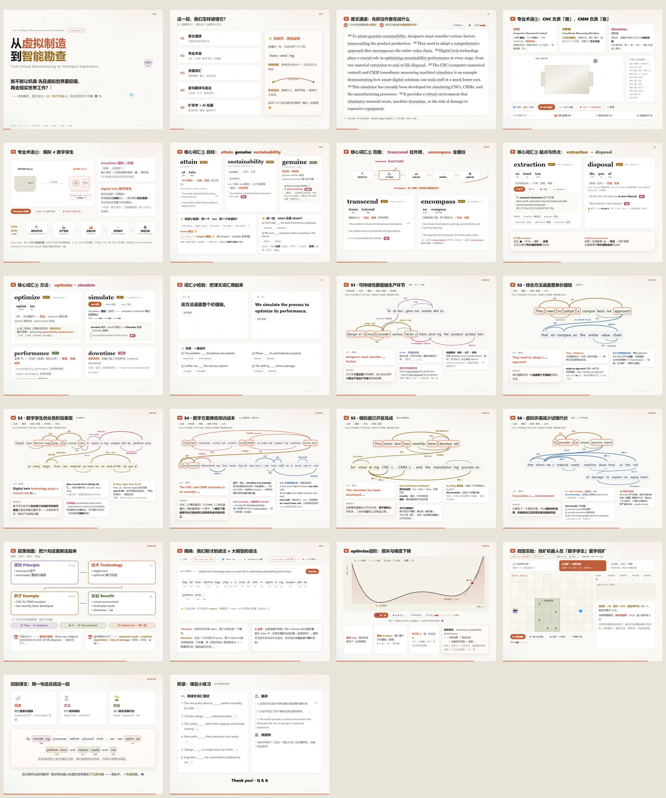

# 卓越研究生英语综合教程2（理工篇）UNIT 1 Reading 第七段讲解

一套用于课堂讲解的交互式 HTML 幻灯片（interactive HTML slides），共 22 页。主题为「从虚拟制造到智能勘查」，围绕 reading材料 的第七段展开。

本项目结合了本人的专业背景，将英语阅读、词汇和语法讲解与矿床学、智能勘查及 AI 联系起来：从 CNC / CMM 模拟器与数字孪生出发，延伸到语言模型、梯度下降，以及找矿机器人的强化学习探索。

## 版本与预览

| 文件 | 用途 |
| --- | --- |
| [16:9 原版](paragraph7.html) | 宽屏演示 |
| [4:3 版本](paragraph7-4x3.html) | 适配 4:3 屏幕的重新排版版本 |
| [4:3 高清 PDF 预览](output/pdf/paragraph7-4x3-preview.pdf) | 22 页，每页一张幻灯片，可放大查看文字与句子连线 |

PDF 展示各页讲解内容展开后的静态画面；动画、悬停释义、朗读与互动实验请打开 HTML 体验。

## 讲解内容

- 原文通读：问题引导、逐句朗读与悬停释义。
- 专业术语：CNC、CMM、模拟器、数字孪生与价值链。
- 关键词汇：词根拆解、词义辨析、例句及互译练习。
- S1–S6 逐句解析：句子主干、修饰关系连线、语法说明与参考译文。
- 专业拓展：Tokenization 与 Attention 示意、损失与梯度下降、找矿机器人强化学习实验。

## 使用方式

下载对应的 HTML 文件，用浏览器直接打开，无需安装或构建。朗读功能取决于浏览器和系统提供的语音。

| 操作 | 快捷键 |
| --- | --- |
| 下一步 / 上一步 | `→` 或空格 / `←` |
| 直接切换幻灯片 | `Shift + → / ←` |
| 首页 / 末页 | `Home` / `End` |
| 目录 / 全屏 | `M` / `F` |
| 帮助 | `?` |

鼠标悬停可查看词义及句子关联，页面上的按钮可操作模拟与实验。

## 制作说明

主题与内容由 GPT-6 Astra、GPT-6.1 Sol、Claude Opus 5.5、DeepSeek-V4.1-Flash 1017 在 Codex 与 DeepSeek Harness 中，经多轮对话制作，并由本人调整与勘误。
